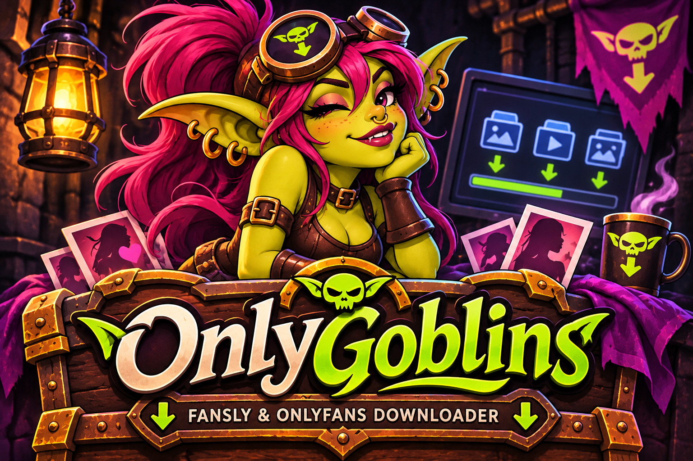

<div align="center">
  

  <h1>OnlyGoblins</h1>

  <p><strong>Your favorite little goblin for hoarding spicy media.</strong></p>

  <p>
    An open-source Fansly &amp; OnlyFans downloader
    with GUI, CLI, incremental downloads and
    smart media management.
  </p>

  <p>
    
    
    
  </p>
</div>

OnlyGoblins is an independently maintained, modified GPL-3.0 project by **ZenoBell**. It builds on Frangus90's Fansly & OnlyFans Downloader NG v1.8.8 and the earlier work of prof79, Avnsx, and other contributors. The independent version series starts at **1.0.0**. Full attribution appears in [CREDITS.md](CREDITS.md).

The maintainer has successfully tested authentication and actual media downloads. Platform APIs, session requirements, and signing rules can change, so future compatibility depends on continued maintenance.

## What it does

| Feature | Fansly | OnlyFans |
| --- | --- | --- |
| Dedicated dark-theme GUI tab | Yes | Yes |
| Timeline and message downloads | Yes | Yes |
| Single post by URL or ID | Yes | Yes |
| Creator list and subscription import | Yes | Yes |
| Collection downloads | Yes | — |
| Photo and video filters | Yes | Yes |
| Incremental history | Timeline and messages | Messages |
| Skip existing media | Hash-based deduplication | Filename/existing-file checks |
| Terminal interface | CLI flags and config | Config-driven CLI |

Fansly setup is optional. With missing Fansly credentials, the GUI opens directly on **OnlyFans**. Existing config filenames, creator state, download folders, and histories remain compatible.

## Windows installation

1. Open [OnlyGoblins Releases](https://github.com/ZenoBell/FanGoblin/releases). Assets will appear after the first release is published.
2. Download `OnlyGoblins-Windows-x64-v1.0.0.zip` and extract the entire ZIP into a writable folder.
3. Run `OnlyGoblins.exe` inside the `OnlyGoblins` folder. Keep its `_internal` and notice folders together.
4. Enter credentials for the platform you use, test the connection, add creators, choose a download folder, and start.

Python is unnecessary for the Windows package. The executable is unsigned. Check the release checksum and source before running software you download.

Some Fansly streaming media needs **FFmpeg** for conversion. Install FFmpeg from [ffmpeg.org](https://ffmpeg.org/download.html), place its `bin` directory on PATH, and restart OnlyGoblins. The public Windows package excludes the opaque FFmpeg binary embedded by the legacy Python wrapper. Direct media downloads use the existing download paths without FFmpeg.

## Run from Python

Python **3.11** is the Windows build and CI target. Linux and macOS source installations are supported on a best-effort basis and have not been verified for this release. Tkinter and a compatible `curl_cffi` wheel are required. On Linux, install your distribution's Tkinter package if it is missing.

```powershell
git clone https://github.com/ZenoBell/FanGoblin.git
cd FanGoblin
py -3.11 -m venv .venv
.\.venv\Scripts\python.exe -m pip install -r requirements.txt
.\.venv\Scripts\python.exe fansly_downloader_gui.py
```

On Linux and macOS, create the environment with `python3 -m venv .venv` and use `.venv/bin/python` in place of the Windows executable path. Run CLI commands from the project folder or the folder containing your private configs. Source installs retain the optional `pyffmpeg` fallback when FFmpeg is absent from PATH. Its separately supplied components have their own licensing terms.

## GUI and authentication

### OnlyFans

Open the **OnlyFans** tab. Copy the complete values from the same current, logged-in browser session into these fields.

| GUI field | Export or cookie value |
| --- | --- |
| Session Cookie | The value of `sess` |
| Auth ID | The value of `auth_id` |
| Auth UID | Optional value of `auth_uid_<account-id>` if present and nonempty |
| User Agent | Complete `user_agent` value |
| X-BC Token | Complete `x_bc` value |

An authenticator's one-time code belongs in the platform's browser login flow. Finish any required verification in your browser before exporting the session. Click **Test Connection**. The in-app **How to get OF credentials?** guide has further instructions.

### Fansly

Open **Fansly → Set Up Fansly…**, supply your own authorization token and user agent, and finish setup. **Skip Fansly Setup** opens OnlyFans. Closing the wizard returns to the main GUI. Fansly's **Connect** button can test an existing configuration. The optional CLI browser-storage helper requires `plyvel-ci` and may inspect local browser storage when credentials need configuration.

### Downloading

Add creator usernames or choose **Import Subs** for your own subscriptions. Select timeline, messages, normal, or single-post mode as appropriate. Fansly also supports collections. Choose media filters and a writable output directory. The **Stop** button requests a graceful stop. **Ctrl+L** opens diagnostics.

## OnlyGoblins Cookie Helper — Easy Authentication

The [browser-extension source](browser-extension/) is included and independently
maintained in this repository. **OnlyGoblins Cookie Helper** lets you explicitly
export your own signed-in OnlyFans session and import it locally into the desktop GUI.
It is derived from [M-rcus's MIT-licensed extension](https://github.com/M-rcus/OnlyFans-Cookie-Helper).

Build with `python browser-extension/build.py` (no JavaScript dependencies).
Packages appear under `browser-extension/dist/`.

- **Firefox 140+:** open `about:debugging#/runtime/this-firefox`, choose **Load Temporary Add-on**,
  and select `manifest.json` in the generated Firefox directory. Allow OnlyFans site access.
  Temporary installation ends on restart. The ZIP is unsigned; permanent installation
  requires Mozilla signing. This modified extension is not claimed to be in any browser store.
- **Chromium:** open `chrome://extensions` (Edge: `edge://extensions`), enable **Developer mode**,
  choose **Load unpacked**, and select the generated Chromium directory.

Sign in normally → select your OnlyFans tab/container in the helper → **Export this session**
→ **Copy JSON** or **Save JSON file** → OnlyGoblins OnlyFans authentication →
**Import from OnlyGoblins Cookie Helper** → paste/select file → validate → confirm saving
→ **Test Connection**. Existing manual authentication remains available.

**Session exports are secrets.** Never share or commit them. Clear clipboard history and
remove exported files after import. Confirmed credentials use the existing local INI file.
There is no automatic browser-to-desktop transfer, telemetry or background token collection.
See the [extension guide](browser-extension/README.md) for full installation, container,
build, licensing, security and maintenance instructions.

## Configuration

| File | Purpose |
| --- | --- |
| `config.ini` | Private Fansly credentials and options |
| `onlyfans_config.ini` | Private OnlyFans credentials and options |
| `gui_state.json` | Fansly creator selections |
| `onlyfans_gui_state.json` | OnlyFans creator selections |
| `download_history.json` in a download directory | Incremental history |
| `log_window_settings.json` | Log window placement |

These filenames are preserved for compatibility and ignored by Git. [config.sample.ini](config.sample.ini) and [onlyfans_config.sample.ini](onlyfans_config.sample.ini) contain placeholders only. Config files store credentials in plaintext, so protect them as you would a password. To reuse an existing installation, copy its private settings locally and keep its download directories and histories intact.

## CLI usage

The inherited Python module names are intentionally retained.

### Fansly

```powershell
python fansly_downloader_ng.py --help
python fansly_downloader_ng.py -u example_creator --timeline
python fansly_downloader_ng.py -i -ni -npox
python fansly_downloader_ng.py --single 1234567890123
```

Use your own creator and post ID. Flags override the Fansly config for the session. Keep authentication in the private config where possible because command-line values may be visible in process listings or shell history.

### OnlyFans

```powershell
python onlyfans_downloader.py
```

The OnlyFans CLI reads `onlyfans_config.ini`. Set `[TargetedCreators] usernames`, `[Options] download_mode` (`Timeline`, `Messages`, `Normal`, or `Single`), `download_directory`, and credentials before running it. For unattended timeline or message runs, set `interactive = False` and `prompt_on_exit = False`. For single-post CLI mode, leave interactive prompting enabled so it can ask for the post. The OnlyFans entry point currently does not parse command-line flags.

## Limitations

- Download only content your account is authorized to access. DRM decryption and paid-content access bypasses are outside the implemented features.
- OnlyFans audio is skipped. OnlyFans collections/vault are unavailable.
- OnlyFans timeline mode checks existing files but does not use a saved timeline cursor. OnlyFans message mode supports incremental history.
- Fansly and OnlyFans have different retry behavior. Fansly includes backoff and rate-limit handling. Some OnlyFans rate-limit paths wait and retry, while other errors can end a run. The OnlyFans `max_retries` setting is stored but is not consistently applied by download loops.
- Credentials expire. A 401/403 can indicate session or platform changes. Sign into the platform in your normal browser, complete any verification, and use matching current session values.
- Automatic and manual in-app update checks are disabled for 1.0.0. Check this project's Releases page for updates. Startup works without GitHub access.
- The Windows streaming-conversion path needs an installed FFmpeg. macOS and Linux binaries are not provided with this release.

## Tests and Windows builds

```powershell
py -3.11 -m venv .venv
.\.venv\Scripts\python.exe -m pip install -r requirements-dev.txt
.\.venv\Scripts\python.exe tools/run_tests.py
.\.venv\Scripts\python.exe -X utf8 build_exe.py
```

The test runner uses synthetic data and isolates Tk GUI cases in separate processes. Tests do not require real cookies. The small GitHub Actions workflow runs these checks on Windows for pushes and pull requests.

The build creates `dist/OnlyGoblins/OnlyGoblins.exe`, `dist/OnlyGoblins-Windows-x64-v1.0.0.zip`, `dist/OnlyGoblins-Source-v1.0.0.zip`, release notes, and SHA-256 checksums. It embeds the new Windows icon and product metadata, includes third-party notices, and refuses to overwrite existing release output. Move an existing build to your own backup location before rebuilding. `build.ps1` calls the same Python build.

The Windows ZIP is assembled from a fresh build and excludes live account config. The source ZIP uses an explicit allowlist. See [docs/RELEASING.md](docs/RELEASING.md) for the exact repository and release commands.

## Privacy and security

Session data is sent to the relevant platform when you authenticate. OnlyFans also fetches public signing parameters from external rule providers. No session values are supplied to those rule-provider requests. Platform and provider connections expose ordinary network metadata to their operators.

Config files, browser exports, logs, creator lists, and downloaded media are private local data. Never attach them to a public issue. Log redaction removes registered authentication values and signed URL queries, but logs can still contain creator names, local paths, and other personal context. Review anything you choose to share. See [SECURITY.md](SECURITY.md).

## Credits and license

OnlyGoblins is an independent modified version of [Frangus90/Fansly-OF-Downloader](https://github.com/Frangus90/Fansly-OF-Downloader), based on v1.8.8 at commit `4777ff4f022126830aa89edab3ae437e5c56a104`. Its history includes [prof79/fansly-downloader-ng](https://github.com/prof79/fansly-downloader-ng) and [Avnsx/fansly-downloader](https://github.com/Avnsx/fansly-downloader). Inherited work remains credited to its authors.

The project is distributed under **GPL-3.0**, with inherited notices preserved in [LICENSE](LICENSE). See [CREDITS.md](CREDITS.md), [CHANGES_FROM_UPSTREAM.md](CHANGES_FROM_UPSTREAM.md), and [THIRD_PARTY_NOTICES.md](THIRD_PARTY_NOTICES.md) for provenance and component licensing. Binary releases include notices and matching project source.

OnlyGoblins has no affiliation with or endorsement from Fansly or OnlyFans. Use it in accordance with applicable laws and the platforms' terms, and only for content you are authorized to access. The software is provided without warranty under its license.
