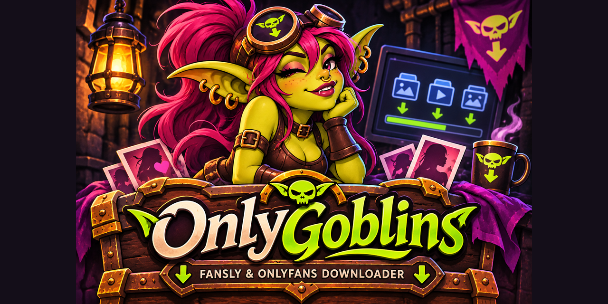

# OnlyGoblins release notes

### 1.0.0 - Unreleased

First independently maintained OnlyGoblins release by ZenoBell, based on Frangus90/Fansly-OF-Downloader v1.8.8 (`4777ff4f022126830aa89edab3ae437e5c56a104`) and earlier work by prof79, Avnsx, and other credited contributors. GPL-3.0 licensing and original notices are retained.

#### Highlights

- Included MIT-licensed OnlyGoblins Cookie Helper source, independent extension version 1.0.0,
  Firefox/Chromium MV3 packages, and explicit local JSON import with confirmation in OnlyFans settings.
- Fansly setup is optional. OnlyFans opens directly when Fansly credentials are missing.
- Fansly setup can be skipped or closed while keeping the main GUI open.
- Independent OnlyFans authentication and settings persistence, updated HTTP transport and signing-rule compatibility, and existing Fansly support.
- OnlyGoblins name, official logo, face icon, product metadata, and independent versioning.
- Safer logging and release packaging, credential-free tests, matching source and third-party notices.

#### Supported workflows

Dark GUI tabs, creator management, subscription import, timeline and message downloads, single posts, Fansly collections, media filters, existing-file skipping, Fansly deduplication, Fansly incremental downloads, and OnlyFans incremental message history. Fansly has CLI flags. The OnlyFans CLI reads its config file.

#### Installation

Extract `OnlyGoblins-Windows-x64-v1.0.0.zip` completely and run `OnlyGoblins/OnlyGoblins.exe`. Keep `_internal` and license notices with the executable. Install FFmpeg on PATH for streaming conversion. Python users can install `requirements.txt` and run `fansly_downloader_gui.py`. See README.md for authentication and CLI setup.

#### Known limitations

Sessions and platform rules can expire or change. OnlyFans audio and collections are unavailable. OnlyFans timelines check existing files rather than resuming a saved timeline cursor. The Windows binary is unsigned. Linux and macOS source runs need separate verification. In-app updates are disabled for this first release. The bundled Windows package uses an external FFmpeg installation for streaming conversion.

The maintainer has tested authentication and actual media downloads. Automated verification uses synthetic fixtures and does not establish future platform compatibility. See CREDITS.md, CHANGES_FROM_UPSTREAM.md, and THIRD_PARTY_NOTICES.md.
